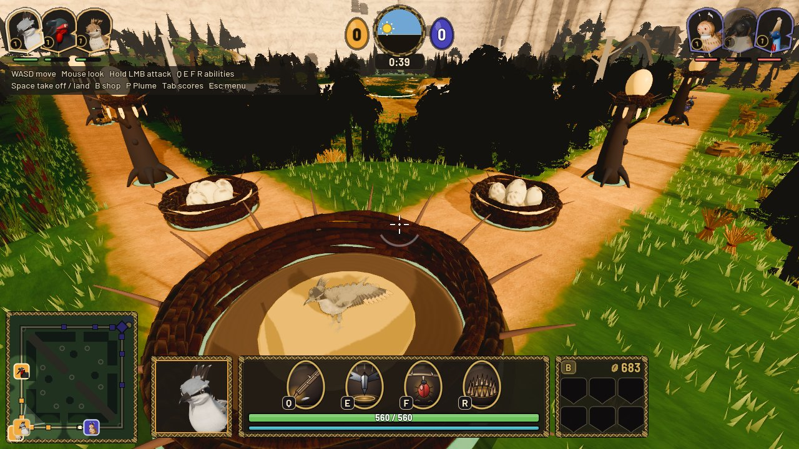

<h1 align="center">🪶 Birnest</h1>

<p align="center">
  <b>A third-person team battle game where every hero is a bird.</b><br>
  Take off, fight down the Flyways, and break the enemy's Great Egg.
</p>

<p align="center">
  <a href="https://github.com/MaxxxFoka/Birnest/releases/latest"><b>⬇ Download the latest beta</b></a> ·
  <a href="#install">Install</a> ·
  <a href="#how-to-play">How to play</a> ·
  <a href="#report-a-bug">Report a bug</a> ·
  <a href="CHANGELOG.md">Changelog</a>
</p>

<p align="center"></p>

> **Closed beta.** Birnest is early and changes every week. Expect bugs, placeholder art
> and balance swings. Your reports shape what we fix next.

## What is Birnest?

Two Clutches, **Sunfeather** and **Duskwing**, defend their Nests on the world of Welkin.
Each team picks birds, pushes waves of woven Fledglings down the Flyways, brings down the
enemy Perches and breaks the Great Egg at the heart of their Nest.

- **Third-person, aimed combat.** You look and aim with the mouse, like a shooter, not by
  clicking on the ground.
- **Flight.** Every bird can take off. Lift drains in the air and refills on the ground, so
  choosing when to fly is half the game.
- **10 birds** in this beta, from the Larder-Keeper Thornback to the River-Spear Plungebright,
  each with four abilities.
- **Seeds and Trinkets.** Last hits pay Seeds; spend them at the Magpie Market in your Nest.
- **Play your way.** Practice against bots offline, or host a lobby and play online with
  friends using an invite code.

## System requirements

| | Minimum | Recommended |
|---|---|---|
| **OS** | Windows 10 64-bit | Windows 11 64-bit |
| **CPU** | 4 cores, 2.5 GHz | 6 cores, 3.5 GHz |
| **Memory** | 8 GB RAM | 16 GB RAM |
| **Graphics** | Vulkan 1.2 GPU, 2 GB (GTX 960 / RX 470 class) | 4 GB+ (GTX 1660 / RX 5600 class) |
| **Storage** | 500 MB free | 1 GB free (replays add up) |
| **Network** | Broadband for online play | |

These are early estimates; tell us if the game runs badly on a PC that meets them. Only
Windows is built for now. macOS and Linux may come later.

## Install

1. Open the [latest release](https://github.com/MaxxxFoka/Birnest/releases/latest) and
   download `Birnest-<version>-windows.zip` from **Assets**.
2. Right-click the zip, choose **Extract All…**, and pick a folder you own, for example
   `C:\Games\Birnest`. Don't run the game from inside the zip.
3. Open the folder and double-click the game's `.exe`.
4. Windows may show **"Windows protected your PC"** because the beta isn't code-signed yet.
   Click **More info**, then **Run anyway**.

Keep every file from the zip together: the game needs the `.pck`, the `.dll` and the
`content` folder next to the `.exe`.

**Updating:** download the new zip and extract it over the old folder (or into a new one).
Your settings, key bindings and replays are kept, because they live in your user profile,
not in the game folder.

**Uninstalling:** delete the game folder. To also remove settings and replays, delete
`%APPDATA%\Godot\app_userdata\` entries for the game.

<details>
<parameter name="command">cd /home/claude/Birnest; rm docs/images/menu.jpg
cat > README.md <<'E'
<h1 align="center">🪶 Birnest</h1>

<p align="center">
  <b>A third-person team battle game where every hero is a bird.</b><br>
  Take off, fight down the Flyways, and break the enemy's Great Egg.
</p>

<p align="center">
  <a href="https://github.com/MaxxxFoka/Birnest/releases/latest"><b>⬇ Download the latest beta</b></a> ·
  <a href="#install">Install</a> ·
  <a href="#how-to-play">How to play</a> ·
  <a href="#report-a-bug">Report a bug</a> ·
  <a href="CHANGELOG.md">Changelog</a>
</p>

<p align="center"></p>

> **Closed beta.** Birnest is early and changes every week. Expect bugs, placeholder art
> and balance swings. Your reports shape what we fix next.

## What is Birnest?

Two Clutches, **Sunfeather** and **Duskwing**, defend their Nests on the world of Welkin.
Each team picks birds, pushes waves of woven Fledglings down the Flyways, brings down the
enemy Perches and breaks the Great Egg at the heart of their Nest.

- **Third-person, aimed combat.** You look and aim with the mouse, like a shooter, not by
  clicking on the ground.
- **Flight.** Every bird can take off. Lift drains in the air and refills on the ground, so
  choosing when to fly is half the game.
- **10 birds** in this beta, from the Larder-Keeper Thornback to the River-Spear Plungebright,
  each with four abilities.
- **Seeds and Trinkets.** Last hits pay Seeds; spend them at the Magpie Market in your Nest.
- **Play your way.** Practice against bots offline, or host a lobby and play online with
  friends using an invite code.

## System requirements

| | Minimum | Recommended |
|---|---|---|
| **OS** | Windows 10 64-bit | Windows 11 64-bit |
| **CPU** | 4 cores, 2.5 GHz | 6 cores, 3.5 GHz |
| **Memory** | 8 GB RAM | 16 GB RAM |
| **Graphics** | Vulkan 1.2 GPU, 2 GB (GTX 960 / RX 470 class) | 4 GB+ (GTX 1660 / RX 5600 class) |
| **Storage** | 500 MB free | 1 GB free (replays add up) |
| **Network** | Broadband for online play | |

These are early estimates; tell us if the game runs badly on a PC that meets them. Only
Windows is built for now. macOS and Linux may come later.

## Install

1. Open the [latest release](https://github.com/MaxxxFoka/Birnest/releases/latest) and
   download `Birnest-<version>-windows.zip` from **Assets**.
2. Right-click the zip, choose **Extract All…**, and pick a folder you own, for example
   `C:\Games\Birnest`. Don't run the game from inside the zip.
3. Open the folder and double-click the game's `.exe`.
4. Windows may show **"Windows protected your PC"** because the beta isn't code-signed yet.
   Click **More info**, then **Run anyway**.

Keep every file from the zip together: the game needs the `.pck`, the `.dll` and the
`content` folder next to the `.exe`.

**Updating:** download the new zip and extract it over the old folder (or into a new one).
Your settings, key bindings and replays are kept, because they live in your user profile,
not in the game folder.

**Uninstalling:** delete the game folder. Settings and replays live under
`%APPDATA%\Godot\app_userdata\`; delete the game's folder there to remove them too.

<details>
<summary><b>Check the download (optional)</b></summary>

Each release also has a `.sha256` file. In PowerShell:

```powershell
Get-FileHash .\Birnest-<version>-windows.zip -Algorithm SHA256
```

The hash should match the one in the `.sha256` file.
</details>

## How to play

### Your first match

1. Launch the game and click **Practice**. Pick a bird and a map: **Canopy** (3v3, two
   Flyways) is the best place to start.
2. A short guide walks you through moving, flying, the shop and your first fight. Press
   **F1** to skip it.
3. Push with your Fledglings, bring down the enemy Perches, then break their Great Egg.

### Play online

The game connects to the beta server by itself: the **Lobby server** field on the main menu
already says `https://2-31-168-73.sslip.io`.

- **Host:** type your name and click **Host a lobby**. Send the invite code to your friends.
- **Join:** type your name, paste the code into **Invite code** and click **Join**.
- Empty slots are filled with bots, so you can play 1v1, 2v2 or a full match with friends.

If you joined a lobby but the match never loads, allow the game through Windows Firewall
(it uses UDP ports 7777 to 7876) and try again.

### Controls

All keys can be changed in **Settings → Controls**.

| Action | Key |
|---|---|
| Move | **W A S D** |
| Look and aim | **Mouse** |
| Attack | Hold **Left mouse** |
| Take off / land (hop when grounded in some spots) | **Space** |
| Abilities 1, 2, 3, ultimate | **Q**, **E**, **F**, **R** |
| Trinkets | **1** to **6** |
| Magpie Market (shop) | **B** |
| Plume card (talents) | **P** |
| Scoreboard | Hold **Tab** |
| Ping | **Alt** or **Mouse 4** |
| Swap camera shoulder | **V** |
| Menu, free the mouse | **Esc** |
| Skip the guide | **F1** |

### Watch and replay

Practice matches are saved as replays when they end or when you leave. Open **Watch** on the
main menu to play them back or to spectate a live online match.

## Report a bug

Found something broken? Please tell us; every report gets read.

1. Go to [**Issues → New issue**](https://github.com/MaxxxFoka/Birnest/issues/new/choose).
2. Pick **Bug report** (or **Feedback** for ideas and balance opinions).
3. Fill in what happened, what you expected, and how to make it happen again. A screenshot
   or a short video helps a lot.

Useful extras:

- **Replay:** if it happened in a practice match, attach the replay. Replays are in
  `%APPDATA%\Godot\app_userdata\<game folder>\replays\` (paste that path into the Explorer
  address bar). Zip the `.bndreplay` file and drag it into the issue.
- **Crash or black screen:** run the game from a Command Prompt in the game folder and copy
  the text it prints into the issue.
- Tell us your **beta version** (the release name, e.g. `v0.1.0-beta.1`), your **GPU** and
  whether you were in **Practice** or **online**.

Please don't post personal information in issues.

## Troubleshooting

| Problem | Try this |
|---|---|
| "Windows protected your PC" | Click **More info → Run anyway**. The beta isn't code-signed yet. |
| The game closes at once or says a `.dll` is missing | Make sure you extracted the whole zip. Install the [Microsoft Visual C++ Redistributable (x64)](https://aka.ms/vs/17/release/vc_redist.x64.exe). |
| Error about Vulkan or a black window | Update your graphics driver from NVIDIA, AMD or Intel. |
| Low frame rate | **Settings → Graphics**: set quality to **Low** and lower the render scale. |
| Can't connect to a lobby | Check that the Lobby server field says `https://2-31-168-73.sslip.io`, and allow the game through your firewall. |
| Mouse is stuck in the window | Press **Esc**. |

## Beta terms

Birnest is in closed beta and is provided as is, for testing only. See
[BETA-TERMS.md](BETA-TERMS.md) for what that means for you. This repository contains only
what players need; the game's source code is not public.

<p align="center"><sub>Birnest is an original game. All names, heroes, art and lore are our own.</sub></p>
